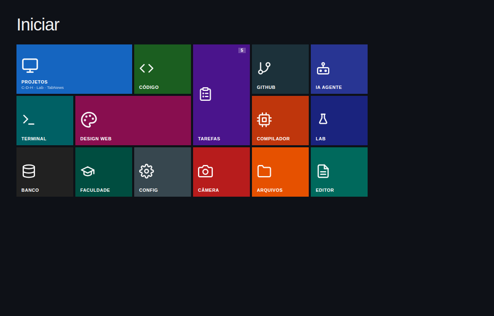
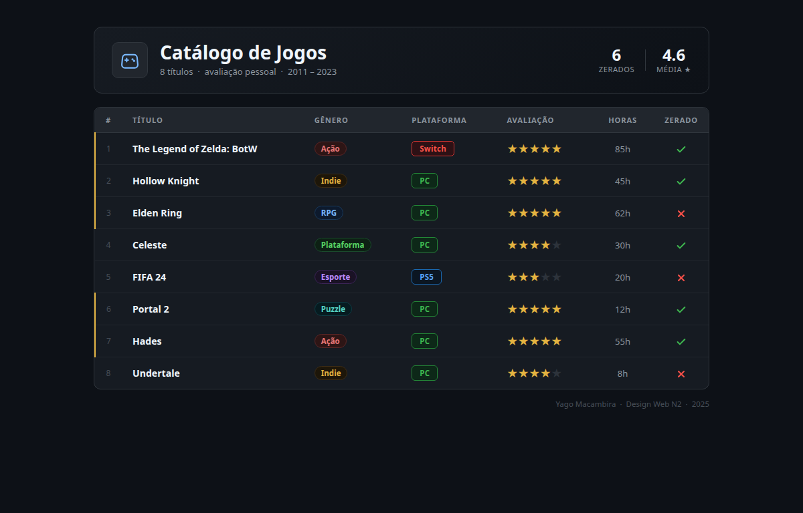
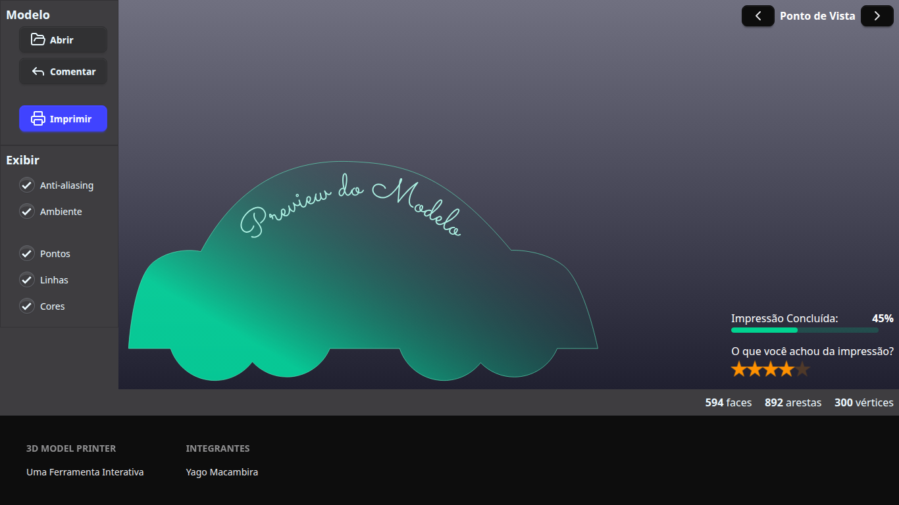
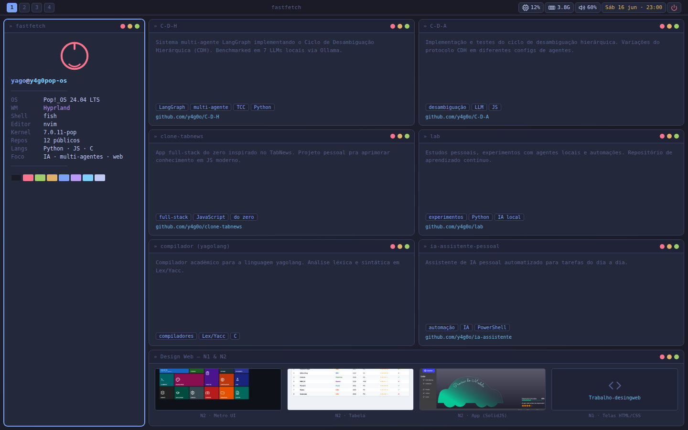

🇺🇸 English · [🇧🇷 Português](README.pt-BR.md)

# desktop-ui-showcase

**Four desktop-style interfaces built for the web: a Metro UI start screen, a games catalog table, a 3D Model Printer app in SolidJS, and a Hyprland-style tiled portfolio in Tokyo Night colors.**

[](LICENSE)


## 📸 Gallery

| | |
|---|---|
|  |  |
| **1 · Metro UI**: tile grid with inline SVG icons | **2 · Games table**: dark catalog with badges, ratings and ✓/✗ |
|  |  |
| **3 · 3D Model Printer** (SolidJS + Tailwind + daisyUI) | **4 · Portfolio**: Hyprland / Tokyo Night tiling |

## 🤔 Why

These were made for the **Design Web (N2)** course, "Desktop" track: the challenge was to recreate desktop paradigms (start screens, data tables, tool windows, tiling window managers) using only web technology. Three of them are plain HTML + CSS you can open straight from disk; one is a small component-driven app.

## ✨ Features

- **`1-metro-ui/`**: Windows-Metro-style start screen ("Iniciar") on a CSS grid with wide/tall tiles, a notification badge, inline SVG icons and a hover brightness effect. Pure HTML/CSS.
- **`2-tabela/`**: "Catálogo de Jogos", a dark-themed table of 8 games with summary stats (completed count, average rating), colored genre/platform badges, star ratings, hours played and SVG ✓/✗ marks; row hover highlight. Pure HTML/CSS.
- **`3-app-componentes/`**: "3D Model Printer", a SolidJS app composed from a local UI kit in `src/ui/` (buttons, panels, sidebar, checkboxes, progress bar, rating, footer, layout helpers, icons) styled with Tailwind CSS 4 and daisyUI 5; components are auto-imported via `unplugin-auto-import`.
- **`4-portfolio/`**: a portfolio dressed as a Hyprland desktop: Waybar-like top bar, a fastfetch window, a terminal window with a benchmark log, project windows with tags, a blinking cursor, and a "Design Web" window that shows thumbnails of the other projects. Tokyo Night palette in CSS variables. Pure HTML/CSS (static content).

## 🚀 Quickstart

```bash
git clone https://github.com/y4g0o/desktop-ui-showcase.git
cd desktop-ui-showcase
```

**Static pages (1, 2, 4)**: no build needed. Open the files in a browser, or serve the repo root so relative image paths work:

```bash
xdg-open 1-metro-ui/index.html      # or: python3 -m http.server 8000  → http://localhost:8000/4-portfolio/
```

**SolidJS app (3)**: needs Node.js:

```bash
cd 3-app-componentes
npm install
npm run dev        # Vite dev server, opens the browser
npm run build      # type-check (tsc -b) + production build into dist/
npm run preview    # serve the build
```

## ⚙️ How it works

- Each project lives in its own numbered folder with its own `index.html`, `style.css` and a `screenshot.png`.
- The portfolio (`4-portfolio/index.html`) reuses the other folders' screenshots through relative paths (`../1-metro-ui/screenshot.png`, …).
- The SolidJS app: `src/index.tsx` renders `src/App_DW.tsx`, which composes screen regions (`BarraLateral`, `Fundo`, `PontoDeVista`, `ImpressaoFeedback`, `BarraStatus`, `Embaixo`) out of components exported by `src/ui/index.ts`. `vite.config.ts` wires the Tailwind, Solid and auto-import plugins; daisyUI themes are declared in `src/index.css`. The model preview is `public/modelo_preview.svg`.

## 🚧 Status & limitations

- **Finished coursework** (June 2026); kept as a showcase.
- UI only: buttons, checkboxes and the 3D app don't perform real actions; the portfolio's fastfetch/terminal data is static mock content and its project links are placeholders (`href="#"`).
- Not responsive: `1-metro-ui` and `4-portfolio` have no viewport meta tag and none of the stylesheets uses media queries.
- Interface text is in Portuguese.
- No automated tests; `npm run build` (which runs `tsc -b`) is the only check.

## 🗺️ Roadmap

1. 📱 Responsive layouts for the Metro UI and the portfolio (viewport meta + media queries).
2. 🔗 Real links in the portfolio project windows.
3. ⌨️ Keyboard-accessible Metro tiles (links/buttons with visible focus).
4. 🧹 Pick one package manager for the SolidJS app (`bun.lock` and `package-lock.json` both exist) and drop the duplicated `modelo_preview.svg`.
5. 🌍 English version of the interface text.

## 🤝 Contributing

Small, focused PRs are very welcome: see [CONTRIBUTING.md](CONTRIBUTING.md) for setup, style, PR flow and good first issues.

## 📄 License

[MIT](LICENSE) © 2026 Yago Macambira
