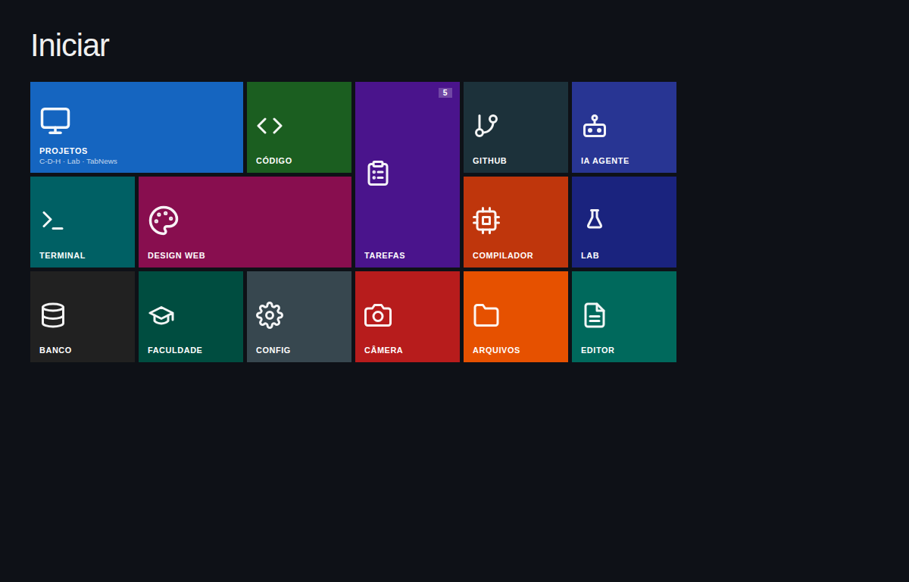
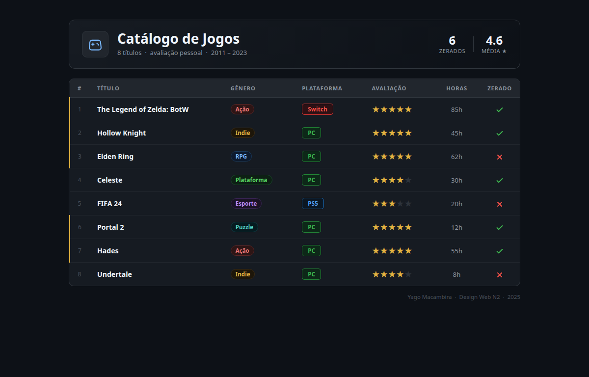
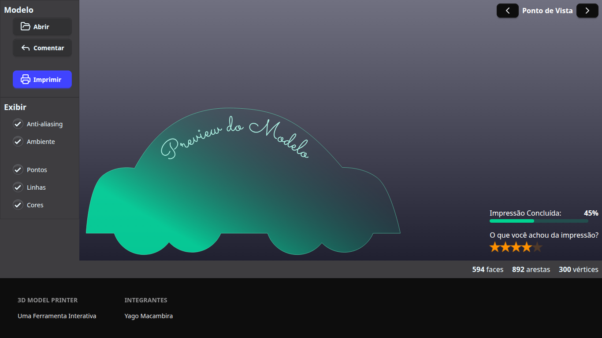
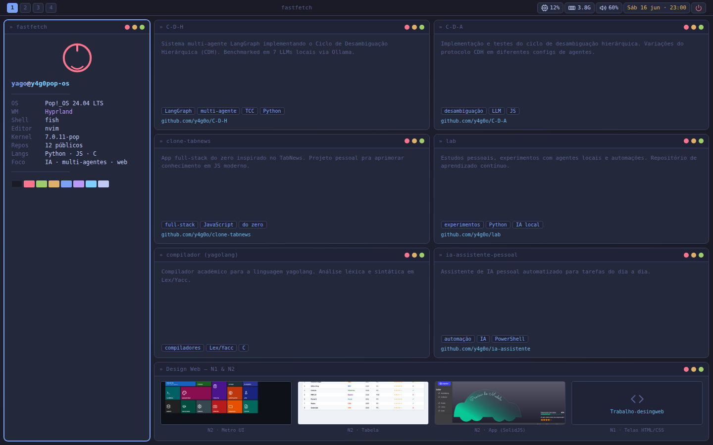

[🇺🇸 English](README.md) · 🇧🇷 Português

# desktop-ui-showcase

**Quatro interfaces em estilo desktop feitas para a web: uma tela inicial Metro UI, uma tabela de catálogo de jogos, um app 3D Model Printer em SolidJS e um portfólio em tiling estilo Hyprland com as cores Tokyo Night.**

[](LICENSE)


## 📸 Galeria

| | |
|---|---|
|  |  |
| **1 · Metro UI**: grade de blocos com ícones SVG | **2 · Tabela de jogos**: catálogo escuro com selos, notas e ✓/✗ |
|  |  |
| **3 · 3D Model Printer** (SolidJS + Tailwind + daisyUI) | **4 · Portfólio**: tiling Hyprland / Tokyo Night |

## 🤔 Por quê

Foram feitos para a disciplina **Design Web (N2)**, "Caminho 1 – Desktop": o desafio era recriar paradigmas de desktop (telas iniciais, tabelas de dados, janelas de ferramenta, gerenciadores de janela em tiling) só com tecnologia web. Três são HTML + CSS puros, que abrem direto do disco; um é um pequeno app feito de componentes.

## ✨ Recursos

- **`1-metro-ui/`**: tela inicial ("Iniciar") no estilo Metro do Windows, em grade CSS com blocos largos/altos, selo de notificação, ícones SVG embutidos e brilho no hover. HTML/CSS puro.
- **`2-tabela/`**: "Catálogo de Jogos", tabela escura com 8 jogos, resumo (zerados, nota média), selos coloridos de gênero/plataforma, estrelas, horas jogadas e marcas ✓/✗ em SVG; destaque da linha no hover. HTML/CSS puro.
- **`3-app-componentes/`**: "3D Model Printer", um app SolidJS montado a partir de um kit de UI local em `src/ui/` (botões, painéis, barra lateral, checkboxes, barra de progresso, avaliação, rodapé, layout, ícones), estilizado com Tailwind CSS 4 e daisyUI 5; os componentes são importados automaticamente pelo `unplugin-auto-import`.
- **`4-portfolio/`**: um portfólio vestido de desktop Hyprland: barra superior estilo Waybar, janela de fastfetch, janela de terminal com log de benchmark, janelas de projetos com tags, cursor piscando e uma janela "Design Web" com miniaturas dos outros projetos. Paleta Tokyo Night em variáveis CSS. HTML/CSS puro (conteúdo estático).

## 🚀 Início rápido

```bash
git clone https://github.com/y4g0o/desktop-ui-showcase.git
cd desktop-ui-showcase
```

**Páginas estáticas (1, 2, 4)**: sem build. Abra os arquivos no navegador, ou sirva a raiz do repositório para os caminhos relativos das imagens funcionarem:

```bash
xdg-open 1-metro-ui/index.html      # ou: python3 -m http.server 8000  → http://localhost:8000/4-portfolio/
```

**App SolidJS (3)**: precisa de Node.js:

```bash
cd 3-app-componentes
npm install
npm run dev        # servidor do Vite, abre o navegador
npm run build      # checagem de tipos (tsc -b) + build de produção em dist/
npm run preview    # serve o build
```

## ⚙️ Como funciona

- Cada projeto fica na sua pasta numerada, com `index.html`, `style.css` e um `screenshot.png` próprios.
- O portfólio (`4-portfolio/index.html`) reaproveita os prints das outras pastas por caminhos relativos (`../1-metro-ui/screenshot.png`, …).
- O app SolidJS: `src/index.tsx` renderiza o `src/App_DW.tsx`, que compõe as regiões da tela (`BarraLateral`, `Fundo`, `PontoDeVista`, `ImpressaoFeedback`, `BarraStatus`, `Embaixo`) com os componentes exportados por `src/ui/index.ts`. O `vite.config.ts` liga os plugins do Tailwind, do Solid e do auto-import; os temas do daisyUI estão em `src/index.css`. A prévia do modelo é o `public/modelo_preview.svg`.

## 🚧 Estado e limitações

- **Trabalho acadêmico concluído** (junho de 2026); mantido como vitrine.
- Só interface: botões, checkboxes e o app 3D não executam ações reais; os dados de fastfetch/terminal do portfólio são estáticos (de mentirinha) e os links dos projetos são provisórios (`href="#"`).
- Não é responsivo: `1-metro-ui` e `4-portfolio` não têm a meta tag de viewport e nenhuma folha de estilo usa media queries.
- Os textos da interface estão em português.
- Sem testes automatizados; o `npm run build` (que roda `tsc -b`) é a única checagem.

## 🗺️ Roteiro

1. 📱 Layout responsivo para a Metro UI e o portfólio (meta viewport + media queries).
2. 🔗 Links reais nas janelas de projetos do portfólio.
3. ⌨️ Blocos da Metro UI acessíveis por teclado (links/botões com foco visível).
4. 🧹 Escolher um só gerenciador de pacotes no app SolidJS (existem `bun.lock` e `package-lock.json`) e remover o `modelo_preview.svg` duplicado.
5. 🌍 Versão em inglês dos textos da interface.

## 🤝 Contribuindo

PRs pequenos e focados são muito bem-vindos: veja o [CONTRIBUTING.md](CONTRIBUTING.md) para preparação, estilo, fluxo de PR e boas primeiras issues.

## 📄 Licença

[MIT](LICENSE) © 2026 Yago Macambira
